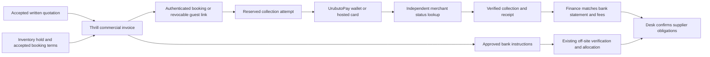

# Thrill Rwanda payment architecture

## Repository audit

The Next.js App Router app uses Better Auth, role-scoped dashboards, Prisma/PostgreSQL, and Vercel or a VPS. Quotes already have immutable snapshots and versioned acceptance. The off-site finance ledger already verifies receipts and separates supplier commitments, fulfilment and customer refund obligations. Hotel direct booking collects at the property. The direct tour and vehicle engine holds inventory before checkout. Transfers have no fleet capacity reservation and enter the desk quotation workflow before collection.

The former gateway initiated external transactions before recording them locally, generated a new reference on each retry, and trusted provider amounts without checking every identity field. The old UrubutoPay event preview used a browser cookie for its most recent test and had no finance ledger. New production flows use the collection service, and the historical register and optional status lookup preserve previous payment records. The simulation is restricted to local development and testing.

## Ownership and routing

PostgreSQL holds invoice amounts and currency, immutable accepted quote data, hashed guest link access, collection attempts, normalized event results and statement evidence. Booking collections mirror independently verified receipts into the existing booking ledger; reports read the new attempts only once. Historical Pesapal rows remain visible under **Payments → Historical payments**. There is no new Pesapal checkout path.

UrubutoPay is the only online route. Eligible methods are the intersection of merchant configuration, Admin routing, charged currency and amount limits. A case with existing off-site payment instructions remains on that payment route until Finance resolves the case. Customer returns and callbacks never determine success. Staff supply separate settlement evidence and keep financial and supplier milestones independent.

The provider boundary lives in `src/lib/collections/provider.ts`. A new provider needs its own authenticated verification, routing approval, reference binding, callback handling and reconciliation tests. Existing provider attempts stay with the original provider.
